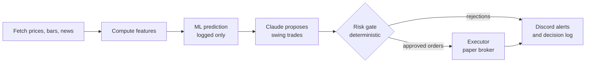

# Trading Agent

A personal trading agent that runs on its own and paper-trades US stocks and crypto. Paper trading means simulated orders on a practice account, with no real money involved. 70% of the account sits in a fixed core of index funds (VOO, QQQM) and a little Bitcoin and Ether. That part follows set rules with no AI in it. The other 30% is a swing budget for 13 large US stocks. A swing trade is held for days to weeks, not bought and sold within one day. For the swing budget, an LLM (Claude) proposes trades, and a deterministic risk engine (plain code with fixed limits) decides whether each trade happens and how big it is. It isn't designed to day-trade and does not use leverage (borrowed money).

> **Disclaimer.** This project trades on paper only. It is not financial advice, and nothing here promises or guarantees any return. Past paper-trading and backtest results do not predict future results. The public copy of this code has its live-trading switch removed, so it cannot trade real money.

## How it works

Every 15 minutes the agent runs one cycle. Stocks are handled while the US market is open; crypto prices are checked around the clock.



1. **Data in.** Stock quotes (Finnhub), daily bars, crypto quotes and news headlines (Alpaca), the VIX volatility index (FRED), the crypto Fear & Greed index, and a calendar of major economic releases.
2. **Features.** Indicators computed from the bars, including `trend_up`: 1 when the last daily close is above its 50-day average and the 20-day average is above the 50-day.
3. **Proposals.** Claude reads the features and answers with `{action, symbol, confidence, reasoning}` for the swing stocks. It sees which swing stocks are held but never how many shares, and never sees the core, the account's money or any risk limit.
4. **Risk gate.** Pure functions apply five layers of rules ([RISK_RULES.md](docs/RISK_RULES.md)): a stop-loss on every position, position sizing (1% of the account at risk per trade, at most 25% of the swing budget in one stock, 20% of it kept in cash), circuit breakers that pause new swing buys after losses, a kill switch at a 15% fall from the swing budget's peak, and smaller or paused buys during high volatility and around major economic news. The core's buys and sells are planned in the same step, by rule.
5. **Executor.** Approved orders go to Alpaca's paper account for stocks and to a built-in simulated broker for crypto.
6. **Alerts.** Discord carries alerts and a weekly report, and takes `/killswitch`, `/resume` and `/status` commands. Every proposal, verdict and order is logged so any trade can be explained afterwards.

## The design choices that matter

- **The LLM can't touch risk limits or sizing.** Claude only proposes; the gate's limits are hard-coded and out of its reach. Why: a model can be wrong, so safety must not depend on its output. ([D-008](docs/DECISIONS.md#d-008--risk-engine-is-deterministic-and-llm-isolated-2026-09-02))
- **Backtests replay the live risk gate.** A backtest replays past market data day by day to see how a strategy would have done. This one calls the same gate function, with the same limits, that the live cycle calls. Why: a separate copy of the rules for testing could quietly drift from the one that trades. Claude itself is not backtested, because it has already read the history it would be trading; a fixed rule stands in for it. ([D-029](docs/DECISIONS.md#d-029---backtests-replay-the-model-through-the-live-risk-gate-day-by-day-not-vectorbt-2026-09-23))
- **A study removed the fixed 3% trailing stop and the ML signal from the prompt.** A trailing stop sells when the price falls a set amount below its recent high. A grid of 144 rule combinations was ranked on one half of the history and reported on the other. The 3% trail was the worst or near-worst exit in every case, and the ML model showed no edge you could trade. The stop is now 3x ATR (average true range, a measure of how far a price typically moves in a day) below the entry, and the model's predictions are logged but no longer shown to Claude. Why: decide on data the choice wasn't tuned on. No combination beat simply buying and holding at the same exposure by more than noise, and the docs say so. ([D-031](docs/DECISIONS.md#d-031---stop-and-signal-study-the-3-trail-and-the-ml-signal-are-what-lose-money-2026-09-23), [D-032](docs/DECISIONS.md#d-032---live-rules-no-fixed-trail-3x-atr-stop-10-position-cap-ml-predictions-leave-the-prompt-2026-09-23))
- **A trend filter on buys and sells.** Code drops any buy unless `trend_up` is 1 and any sell unless it is 0, and the gate never adds to a stock already held. Why: the prompt is guidance and the filter is the guarantee. The sell rule was added after Claude sold two stocks in an uptrend against its instructions. ([D-038](docs/DECISIONS.md#d-038---claudes-entries-are-steered-by-the-2050-day-trend-filter-the-gate-never-adds-to-a-held-position-2026-09-23), [D-060](docs/DECISIONS.md#d-060---a-sell-stands-only-when-its-trend_up-is-0-and-claudes-reasoning-is-stored-jason-2026-10-17))
- **The app holds the stops on fractional positions.** Swing buys are fractional shares (orders of at least $10), and Alpaca won't hold a lasting stop order on a fraction. So every cycle the app compares each position's price with its stop and sells in full at or below it. Why: fractional buys let a small budget trade at all. The cost, stated in the docs: there is no stop while the agent isn't running. ([D-054](docs/DECISIONS.md#d-054---fractional-swing-positions-the-app-holds-their-stop-jason-2026-10-10))
- **A pass/fail bar set in advance.** The [spec](docs/SPEC.md) says what "done" means. Before any real money, the swing trades must make at least +5% on the money put into them, after fees, over a 4-week paper window with no rule changes. Why: a bar fixed beforehand can fail, so a result can't be reinterpreted after the fact. ([D-064](docs/DECISIONS.md#d-064---the-spec-two-finish-lines-a-4-week-paper-test-and-a-5-swing-bar-jason-2026-10-18))

The full design is in [ARCHITECTURE.md](docs/ARCHITECTURE.md), and the reasoning behind each choice is in the [decision log](docs/DECISIONS.md).

## Stack

| Tool | What it does here |
|---|---|
| Python 3.11+ | The whole agent: pydantic for config and models, structlog for JSON logs, pytest and ruff for tests and lint. |
| LangGraph | Runs the cycle as a graph of steps and saves its state to Postgres, so a cycle that crashes mid-order resumes instead of re-ordering. |
| Claude (Anthropic API) | The analyst that proposes swing trades. |
| TimescaleDB | One Postgres database for price history and for trades, orders, snapshots and every decision. |
| Redis | The kill-switch flag, circuit-breaker cooldowns and the in-flight cycle id. |
| Celery | A background worker for slow jobs: the weekly model retrain and news scoring, so the cycle never waits on them. |
| XGBoost | A directional price model. Its predictions are logged for evaluation, not traded on. |
| FinBERT | Scores news headlines; the last 24 hours of sentiment is one of Claude's inputs. |
| Alpaca | Stock paper trading, plus daily bars, crypto quotes and news. |
| Discord | Alerts, the weekly report and the `/killswitch`, `/resume` and `/status` commands. |
| Docker Compose | Runs TimescaleDB, Redis and the worker locally; the agent runs on the host. |
| GitHub Actions | CI on every pull request: lint, the full test suite against real TimescaleDB and Redis, and a size check. |

## How it was built

Jason Lam directed the work. AI coding agents implemented it under a written spec and an append-only decision log. Every change was independently reviewed; since mid-October that review is an automated gate on every pull request, and Jason merges each one.

## Run it locally

You need Docker, Python 3.11+, API keys for Alpaca (a paper account), Anthropic, Finnhub and FRED, and a Discord bot. The Anthropic API is paid per use. **Any exchange API key you create must never have withdrawal permission.** The agent runs in paper mode (`TRADING_MODE=paper`).

```bash
cp .env.example .env                 # fill in your keys; .env stays out of git
docker compose up -d                 # TimescaleDB, Redis and the background worker
python -m venv .venv
source .venv/bin/activate            # Windows (Git Bash): source .venv/Scripts/activate
pip install -e ".[dev]"
pytest                               # the test suite (needs the containers running)
python -m trading_agent.portfolio.ledger start   # once, before the first cycle: sets up the 70/30 core + swing split
python -m trading_agent.main --once  # one cycle, then exit
python -m trading_agent.main         # 15-minute cycles and the Discord bot, until Ctrl+C
```

Other commands:

```bash
python -m trading_agent.ml.train         # retrain the directional model
python -m trading_agent.backtest.run     # replay the model through the risk gate on history
python -m trading_agent.backtest.study   # the stop-loss x signal study
python -m trading_agent.reports.weekly   # print last week's report
```

## License

MIT, copyright Jason Lam. See [LICENSE](LICENSE).
